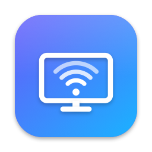

<p align="center"></p>

<h1 align="center">TV Display</h1>

<p align="center">Turn an Android TV into a wireless second screen for your Mac.<br>
Drag a window onto it and it shows up on the TV about 65 ms later.</p>

<p align="center"><a href="https://tv-display-sandy.vercel.app">Website & downloads</a> · <a href="CONTRIBUTING.md">Contributing</a></p>

<p align="center"><a href="https://github.com/raufhm/tv-display/actions/workflows/build.yml"></a></p>

---

Two small apps:

- **Mac (`mac/`)**: a menu-bar app that adds a real extra display to macOS (it appears in System Settings → Displays), captures it, encodes it with the Mac's hardware H.264 encoder, and streams it over your local network. It can also send the Mac's sound to the TV.
- **TV (`tv/`)**: a 97 KB Android TV app with no libraries. It decodes the stream with the TV's hardware video decoder straight onto the screen and shows its IP address while it waits.

No cables, no ads, no accounts. Nothing leaves your network.

| | |
|---|---|
| Resolution | 1280 × 720 |
| Frame rate | ~55 fps (30 or 60 selectable) |
| Latency | 63–70 ms typical, capture on the Mac → decoded on the TV |
| Bitrate | 5, 8 or 12 Mbps cap |
| Audio | optional, 48 kHz stereo (macOS 14.2+) |
| Text size | Normal (1280×720), Larger (960×540 at 2×), Largest (800×450 at 2×) |

Measured on a TCL Android TV (Realtek RTD284x, Android 9) over home Wi-Fi with an M1 Pro MacBook Pro.

## Install

Grab the builds from the [website](https://tv-display-sandy.vercel.app) or [Releases](https://github.com/raufhm/tv-display/releases).

**TV** (Android TV / Google TV 9+): install *Downloader* from the Play Store and open `tv-display-sandy.vercel.app/tv`, or sideload with adb:

```bash
adb connect <tv-ip>:5555
adb install TV-Display.apk
```

**Mac** (macOS 14+, Apple silicon or Intel): open the DMG and drag *TV Display* to Applications. The app isn't notarized, so macOS blocks the first launch: click **Done**, then **System Settings → Privacy & Security → Open Anyway**. Or:

```bash
xattr -dr com.apple.quarantine "/Applications/TV Display.app"
```

Open *TV Display* on the TV. On the Mac, the app finds the TV on your network by itself (macOS asks to allow finding local network devices) and connects within a couple of seconds. Allow Screen Recording when asked. Next time, just open TV Display on the TV again: the Mac keeps looking and connects as soon as it's open. If the TV isn't found, pick **TV → Enter Address Manually…** and type the address shown on the TV.

## Build from source

No Xcode project and no Gradle. Each app builds with one script.

**Mac:** needs the Xcode Command Line Tools (`xcode-select --install`).

```bash
cd mac
./build.sh run        # build and open "TV Display.app"
./build.sh install    # copy it to /Applications
./build.sh dmg        # build TV-Display.dmg
```

**TV:** needs the Android SDK at `~/Library/Android/sdk` (or `$ANDROID_HOME`) with build-tools 35.0.0 and platform android-34, plus a JDK.

```bash
cd tv
./build.sh                             # build build/tv-screen.apk
TV=192.168.1.20 ./build.sh install     # install on the TV over adb and launch it
```

The first build creates `tv/signing.keystore`. Keep it private and keep it around: Android only accepts updates signed with the same key.

**Icons:** `art/make-icons.swift` draws every icon (Mac app icon, TV launcher icon and banner) from one design. `mac/build.sh` runs it automatically.

**Website:** `site/` is a single static page deployed on Vercel.

## How it works

```
Mac                                                         TV
virtual display → ScreenCaptureKit → VideoToolbox H.264 ──TCP──→ MediaCodec → SurfaceView
                  (only that display)  (real time, no B-frames)        (hardware decode)
Core Audio tap ──────────────────────── 16-bit PCM ────────TCP──→ AudioTrack (low latency)
```

- **Virtual display:** `CGVirtualDisplay`, a private CoreGraphics API (the same one [DeskPad](https://github.com/Stengo/DeskPad) uses). Quitting the app removes the display.
- **Latency control:** the TV acknowledges every frame it decodes, and the Mac keeps at most 4 frames in flight. The TV's display is locked to 60 Hz, so without this a surplus would queue up and latency would keep growing. The Mac skips frames *before* encoding, so the stream never breaks.
- **Static screens:** many TV decoders only release a frame once later frames arrive, so when nothing changes the Mac re-sends the last frame (about 100 bytes) at a steady rate.
- **Finding the TV:** while TV Display is open, the TV announces itself over Bonjour as `_tvdisplay._tcp`, with its IPv4 address and port in the TXT record. The Mac lists every TV it finds under *TV* and follows the chosen one by name, so a new address from the router doesn't matter.
- **Text size:** *Larger* and *Largest* switch the virtual display to a 2× (Retina) mode, so macOS draws a smaller desktop with more pixels, which is then scaled to the 720p stream: bigger text that stays sharp.
- **Self-healing:** if the TV stops confirming frames for 3 seconds (restarted, unplugged, off Wi-Fi), the Mac drops the connection and reconnects. A new connection replaces a stuck one. If the decoder wedges, the TV rebuilds it and asks the Mac for a key frame.
- **Sound:** with *Sound → TV Speakers*, a Core Audio process tap captures everything the Mac plays and mutes it locally while it's sent to the TV.

Wire format (big-endian), Mac → TV: `int32 length, byte type, int64 capture time (µs), payload`. The types are 0 = SPS+PPS, 1 = key frame, 2 = frame (Annex-B H.264), 3 = audio format, 4 = PCM audio. TV → Mac: `int64` capture time of each decoded frame, or −1 to request a key frame. The TV listens on port 7777.

## Limitations

- 720p only, matching most budget TVs.
- The Mac and TV must be on the same network.
- Uses a private macOS API, so a future macOS update could break it.
- Not notarized (that needs a paid Apple Developer account).

## Contributing

Issues and pull requests are welcome. Start with [CONTRIBUTING.md](CONTRIBUTING.md), and if you try it on a new TV, please [send a TV report](https://github.com/raufhm/tv-display/issues/new?template=tv_report.yml). Ideas that would help:

- Pairing and encryption, so other devices on the network can't view or take over the stream
- 1080p for TVs whose decoder can keep up
- Test results from other TV brands and chips
- Notarized release builds

Please keep the TV app free of libraries and both builds free of IDE projects, so anyone can build them with one command. Report security problems privately (see [SECURITY.md](SECURITY.md)). This project follows the [Contributor Covenant](CODE_OF_CONDUCT.md).

## License

[MIT](LICENSE)
